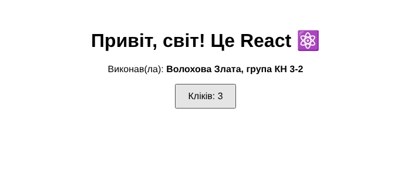
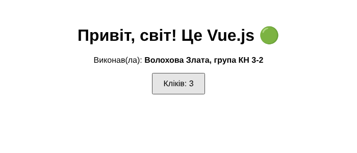
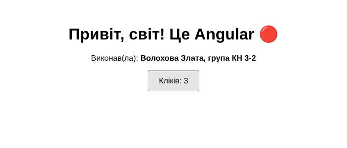

# frameworks-intro

Практична робота №1 — «Ознайомлення з сучасними фронтенд-фреймворками» (дисципліна «Фреймворки JavaScript»).

Виконав(ла): Волохова Злата, група КН 3-2

Три незалежні додатки з кнопкою-лічильником:

| Папка | Технологія | Запуск |
|---|---|---|
| `react-app/` | React + Vite (`useState`) | `npm install && npm run dev` |
| `vue-app/` | Vue 3 + Vite (`ref`, Composition API) | `npm install && npm run dev` |
| `angular-app/` | Angular (standalone, Signals) | `npm install && npm start` |

`node_modules/` та `dist/` не зберігаються в репозиторії (див. `.gitignore`); залежності відновлюються командою `npm install`.

## Скріншоти

### React

### Vue.js

### Angular

